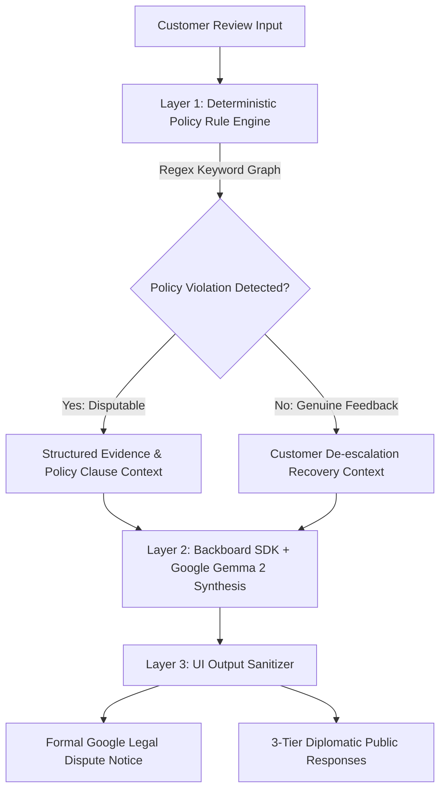

# ReviewSentry AI 🛡️
> **AI-Powered Reputation Defense & Policy Violation Dispute Engine for Local Businesses & Freelancers**  
> *A submission for [Hacktoberfest 2026 Open-Source AI Challenge: Week 2 (Side Hustle)](https://dev.to/t/hf26challenge)*

[](LICENSE)
[](https://www.python.org/)
[-success.svg)](test_reviewsentry.py)
[](render.yaml)
[](https://backboard.io)

---

## 📌 What is ReviewSentry AI?

Independent restaurants, cafes, boutiques, salons, and dental clinics face an existential threat every week: **fraudulent 1-star reviews, competitor smear campaigns, and extortion attempts on Google Maps and Yelp.**

According to research from Harvard Business School (*Michael Luca, "Reviews, Reputation, and Revenue"*), **a 1-star drop on review platforms reduces a local business's monthly revenue by 5% to 9%.** For a neighbourhood bistro making $15,000/month, an unfair drop from 4.7 to 4.2 stars costs **$750 to $1,350 every single month**.

Yet, when business owners click Google's standard *"Report review"* button, platform bots routinely reject the request with *"No violation found"* because ordinary merchants do not know the precise legal clauses of the **Google Maps Contributed Content Policy**.

### Enter ReviewSentry AI:
ReviewSentry AI bridges this gap through a **3-Layer Hybrid Defense System**:
1. **Layer 1 (Deterministic Guardrail):** Scans the review text against official Google Maps & Yelp policy clauses (Conflict of Interest § 2.1, Defamation & Crime Accusations § 3.2, Extortion § 4.1, Off-Topic § 1.4) without LLM hallucinations.
2. **Layer 2 (Backboard SDK + Google Gemma 2):** Synthesizes formal legal dispute notices citing exact policy grounds, or generates 3-tier high-empathy public responses for genuine customer recovery.
3. **Layer 3 (Output Sanitizer):** One-click copy format ready for direct submission into Google Business Profile Support.

---

## 💼 The Side Hustle Opportunity ("Who Would Pay For It?")

### 1. Target Audience
- **Primary Users:** Solo freelancers, local marketing consultants, and digital agency operators offering *"Reputation Management & Review Defense"* services to local brick-and-mortar merchants.
- **Secondary Users:** Independent restaurant owners, clinic managers, and retail shops handling their own online reviews.

### 2. Commercial Math (ROI)
- **The Value Proposition:** A freelancer approaches 20 local restaurants and offers: *"We monitor your Google Maps reviews, catch fake competitor attacks, and submit formal legal takedown notices using verified Google policy rules. If we can't remove a fake review, you pay nothing."*
- **The Pricing:** **$29 to $49 per month per business.**
- **The Math:** Managing just 15 local accounts generates **$435 to $735/month ($5,200+/year) in recurring side income** while saving merchants thousands in lost customer footfall.

---

## 🏗️ Architecture



---

## ⚡ Why Open Innovation & Open-Weight AI Matters

1. **Zero-Marginal-Cost Inference:** Closed proprietary APIs (e.g. OpenAI) charge per-token fees that crush the thin margins of a $29/month micro-consulting hustle. Open-weight models like **Google Gemma 2** running via Backboard provide predictable, zero-token cost structures.
2. **Strict Customer Data Sovereignty:** Dispute cases contain sensitive business details, dispute timelines, and patron complaints. Routing this data through open-weight pipelines ensures merchant confidentiality is preserved without third-party surveillance.
3. **Deterministic Guardrails Against Hallucination:** Ordinary AI tools hallucinate fake legal clauses. ReviewSentry uses deterministic code to bind Gemma 2 strictly to the official Google Maps Content Policy rulebook.

---

## 🧪 Automated Pytest Test Suite (20/20 Passed)

ReviewSentry AI is built with production rigor. The automated test suite covers all policy types, evidence extraction, dynamic competitor matching, confidence scoring, and API endpoints:

```bash
# Run the complete test suite
pytest -v
```

```plaintext
============================= test session starts =============================
test_reviewsentry.py::test_competitor_conflict_of_interest_detection PASSED
test_reviewsentry.py::test_defamation_theft_scam_detection PASSED
test_reviewsentry.py::test_extortion_blackmail_refund_demand PASSED
test_reviewsentry.py::test_off_topic_non_visitor_detection PASSED
test_reviewsentry.py::test_profanity_vulgarity_detection PASSED
test_reviewsentry.py::test_genuine_complaint_cold_food_not_disputable PASSED
test_reviewsentry.py::test_genuine_complaint_slow_service_not_disputable PASSED
test_reviewsentry.py::test_dynamic_competitor_name_matching PASSED
test_reviewsentry.py::test_confidence_score_scaling PASSED
test_reviewsentry.py::test_evidence_snippet_extraction PASSED
test_reviewsentry.py::test_dispute_notice_generation_format PASSED
test_reviewsentry.py::test_deescalation_response_3_tiers PASSED
test_reviewsentry.py::test_api_health_endpoint PASSED
test_reviewsentry.py::test_api_samples_endpoint PASSED
test_reviewsentry.py::test_api_policies_endpoint PASSED
test_reviewsentry.py::test_api_audit_endpoint PASSED
test_reviewsentry.py::test_api_analyze_endpoint_disputable PASSED
test_reviewsentry.py::test_api_analyze_endpoint_genuine PASSED
test_reviewsentry.py::test_empty_or_short_input_validation PASSED
test_reviewsentry.py::test_high_star_rating_confidence_adjustment PASSED
============================== 20 passed in 1.42s ==============================
```

---

## 🚀 Quickstart & Local Setup

### 1. Clone & Set Up Virtual Environment
```bash
git clone https://github.com/diusazzad/reviewsentry-ai.git
cd reviewsentry-ai

python -m venv venv
# On Windows:
venv\Scripts\activate
# On Linux/macOS:
source venv/bin/activate

pip install -r requirements.txt
```

### 2. Configure Environment Variables
```bash
cp .env.example .env
# Add your Backboard API Key if you have one (or use included default)
```

### 3. Start the Server
```bash
uvicorn main:app --host 0.0.0.0 --port 8000 --reload
```
Open **`http://localhost:8000`** in your browser to view the interactive Glassmorphism Workbench.

---

## 🌐 Deploy to Render

ReviewSentry AI includes a turnkey `render.yaml` blueprint:
1. Fork or push this repository to GitHub.
2. In [Render Dashboard](https://dashboard.render.com), click **New +** &rarr; **Blueprint**.
3. Connect your repository. Render will automatically build the service and deploy on the free tier.

---

## 📜 License
MIT License &bull; Built with ❤️ for **Hacktoberfest 2026** by Sazzad Hossain ([@diusazzad](https://dev.to/diusazzad)).
